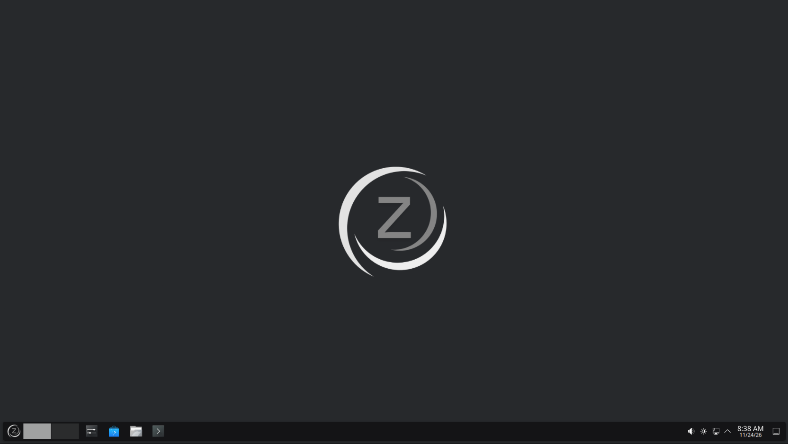
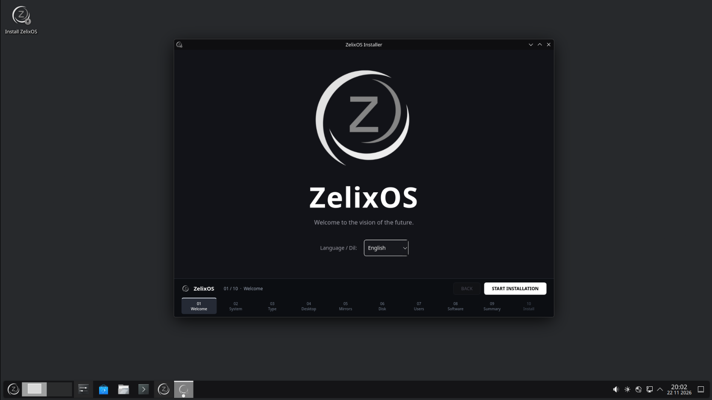
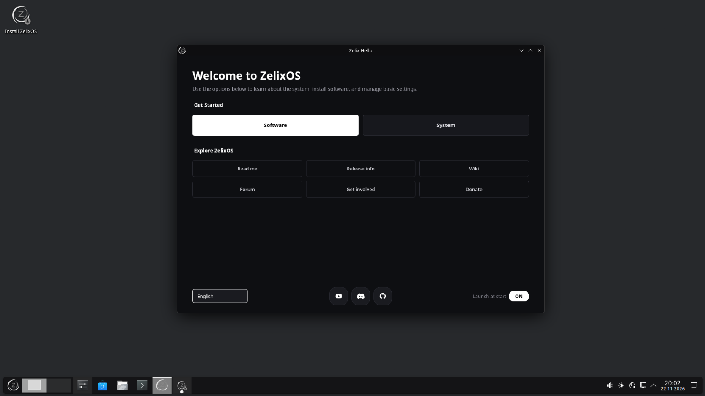
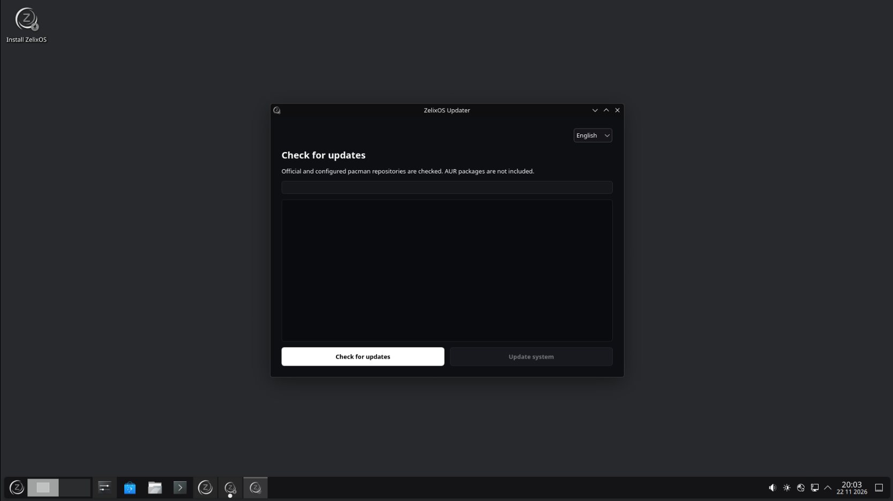
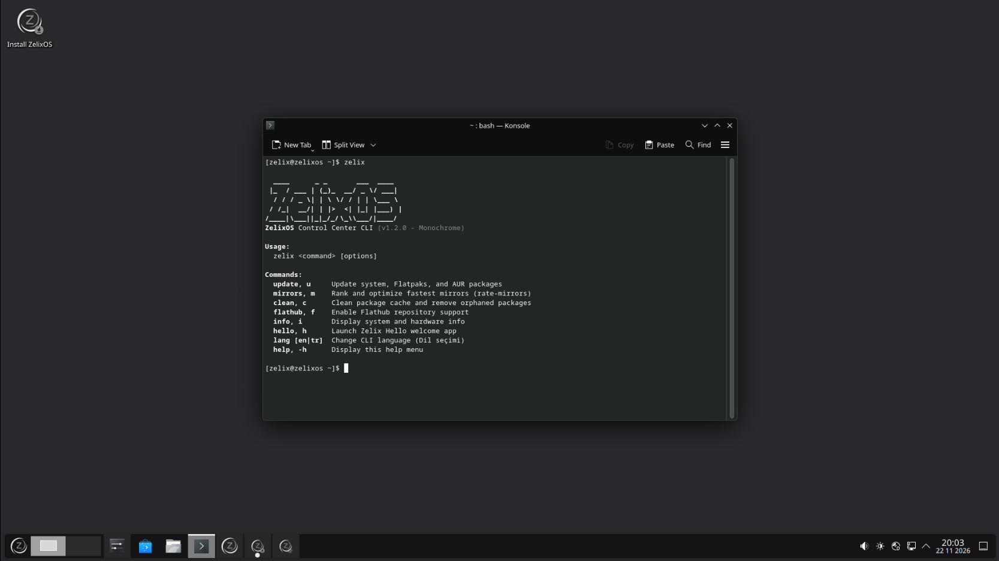
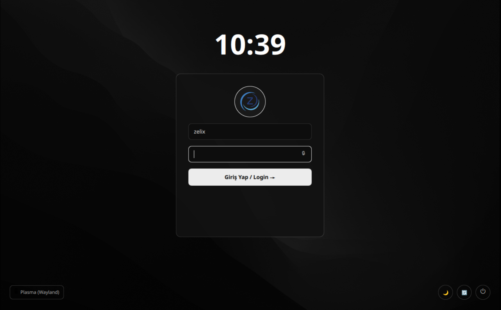

# ZelixOS

ZelixOS is an Arch Linux based distribution with a graphical installer, a customized desktop, and its own tools for software management and system maintenance. Aurora brings these components together with a dark appearance and a choice of desktop environments and window managers.

This is the main ZelixOS project repository. It brings together the live system profile, application source repositories, build tools, and development documentation. The repository name, `zelixiso`, reflects its role in producing the installation image.

[Download ZelixOS](https://zelixos.com/download/) · [Documentation](https://zelixos.com/docs/) · [Release downloads](https://github.com/ZelixOS/zelixiso/releases) · [Report an issue](https://github.com/ZelixOS/zelixiso/issues)



Project applications and the installer provide English, Turkish, and Spanish interfaces. Language availability can differ in external tools and package output, which follow their own locale settings.

## What ZelixOS provides

- An Arch Linux base with pacman and rolling package updates.
- A live desktop for trying the system and starting installation.
- Zelixins, a graphical installer built around Archinstall.
- A choice of KDE Plasma, GNOME, Xfce, Hyprland, Sway, i3, and bspwm during installation.
- Zelix Hello for getting started, managing applications, and accessing system tools.
- Zelix Updater for checking and installing updates from configured pacman repositories.
- Zelix CLI for common update and maintenance tasks in the terminal.
- Aurora appearance settings, wallpapers, and desktop-specific defaults.
- English, Turkish, and Spanish interfaces in the ZelixOS applications and installer.

## Prepare to install

1. Download an ISO from the [ZelixOS download page](https://zelixos.com/download/) or [GitHub Releases](https://github.com/ZelixOS/zelixiso/releases). Use the checksum published with the same release when one is provided.
2. Write the ISO to a USB drive with an image-writing tool. Writing the image erases the selected USB drive; verify its device name before confirming.
3. Boot the USB from the machine's firmware boot menu. Note whether it starts in UEFI or legacy BIOS mode because the bootloader choice must match.
4. Connect to the internet in the live session. The installer downloads packages from Arch mirrors and ZelixRepo.
5. Open **Install ZelixOS** from the desktop. Follow the ten screens below and review the proposed disk layout before starting.

Zelixins requires an internet connection and a target disk of at least 25 GiB. See the [website installation guide](https://zelixos.com/docs/) for media preparation and further help.

> **Disk warning:** Zelixins automatically partitions and formats the whole selected disk. It does not currently provide manual partition editing or disk encryption. Back up important data and disconnect drives that are not installation targets before continuing.

## Ten screens in the installer

The full step-by-step guide, including filesystem options and troubleshooting, is in the [Zelixins README](https://github.com/ZelixOS/zelixins#installation-walkthrough).

1. **Welcome:** choose the installer interface language: English, Turkish, or Spanish.
2. **System:** select the installed-system locale, keyboard layout, time zone, one or more kernels, and a firmware-compatible bootloader.
3. **Type:** choose Minimal, Standard, Full Experience, or Custom. The profile preselects packages and optional appearance components.
4. **Desktop:** select KDE Plasma, GNOME, Xfce, Hyprland, Sway, i3, or bspwm, then choose a login manager compatible with all selected sessions.
5. **Mirrors:** select nearby package mirror regions; the worldwide mirror is selected by default.
6. **Disk:** choose the target disk and filesystem, optionally create a separate `/home`, and inspect the generated partition preview. This selection is destructive.
7. **Users:** set the optional root password and add at least one regular user. Choose whether the user has `sudo` administrator access.
8. **Software:** review the profile's applications and select optional Arch/ZelixRepo, Flatpak, or AUR packages. Appearance components are selected with the installation type on screen 3.
9. **Summary:** verify the disk, locale, sessions, login manager, mirrors, kernels, bootloader, accounts, and packages. Go back to correct any choice.
10. **Install:** confirm the disk operation, keep the system powered on, and follow the live progress log. After success, restart, remove the USB, and sign in with the created user.

## The installer

Zelixins guides you through system configuration with a graphical interface. It supports kernel and bootloader selection, multiple desktop sessions, compatible login managers, and optional software. Installation output is displayed in the interface, including failures during installation and post-install configuration.



The installer uses Archinstall for the base installation, then applies ZelixOS configuration and installs the distribution's application packages. Disk and boot compatibility checks help validate the selected configuration before installation starts.

## Desktop choices

Choose a full desktop environment or a window manager during installation. When several environments are selected, each is available as a separate login session. Login manager choices are restricted to combinations supported by the selected environments.

| Environment | Session | Default direction |
| --- | --- | --- |
| KDE Plasma | Wayland | A familiar panel layout with Aurora appearance settings |
| GNOME | Wayland | An Activities and workspace based workflow |
| Xfce | X11 | A traditional desktop with a panel and application menu |
| Hyprland | Wayland | Dynamic tiling with Waybar and Wofi |
| Sway | Wayland | Tiling with an i3-style keyboard workflow |
| i3 | X11 | Keyboard-driven tiling and workspaces |
| bspwm | X11 | Tree-based tiling with sxhkd shortcuts |

Desktop-specific defaults include wallpapers, appearance settings, and selected session tools. See the [desktop configuration guide](docs/DESKTOPS.md) for supported login manager combinations and implementation details.

## Zelix applications

| Application | Purpose | Source |
| --- | --- | --- |
| Zelix Hello | Welcome page, application management, driver suggestions, and system tools | [zelix-hello](https://github.com/ZelixOS/zelix-hello) |
| Zelixins | Graphical installation and post-install configuration | [zelixins](https://github.com/ZelixOS/zelixins) |
| Zelix Updater | Update checks and system upgrades through pacman | [zelix-updater](https://github.com/ZelixOS/zelix-updater) |
| Zelix CLI | Terminal commands for updates, mirrors, maintenance, and system information | [zelix-cli](https://github.com/ZelixOS/zelix-cli) |
| ZelixPen | On-screen drawing and annotation, available from the package repository | [zelixpen](https://github.com/ZelixOS/zelixpen) |

| Zelix Hello | Zelix Updater |
| --- | --- |
|  |  |

Zelix CLI help is available directly in the terminal:



Zelix Hello provides access to Arch packages, Flatpak, and AUR installation paths. These sources use their respective tools. Zelix Updater handles configured pacman repositories; AUR and Flatpak updates are managed separately or through the CLI.

## Appearance

Aurora provides a dark visual style, wallpapers, and a themed login experience. KDE Plasma uses the Zelix Aurora look and feel with a white accent. Other desktop choices receive their own initial appearance settings.



Screenshots show existing Aurora builds. Interface details and defaults may differ between releases.

## Packages and updates

ZelixOS uses pacman for system packages. On an installed system, update all configured repositories with:

```bash
sudo pacman -Syu
```

The [Zelix package repository](https://github.com/ZelixOS/zelix-repo) maintains distribution application recipes and repository indexes. Package archives are distributed through its [stable release](https://github.com/ZelixOS/zelix-repo/releases/tag/stable).

With `zelixrepo` configured, install companion applications with:

```bash
sudo pacman -Syu zelix-hello zelix-updater zelix-cli zelixpen
```

The CLI provides a summary of its commands with `zelix help`. Package and application changes do not require downloading a new ISO for every update; installation images and installed system packages are distributed separately.

## Repository structure

| Path | Contents |
| --- | --- |
| `iso_root/` | Archiso profile, live system files, package list, and boot configuration |
| `zelixins/` | Installer source submodule |
| `zelix-hello/` | Welcome application source submodule |
| `zelix-updater/` | Updater source submodule |
| `zelix-repo/` | Package recipes and packaging source submodule |
| `scripts/` | Source synchronization, package builds, ISO builds, and verification |
| `tests/` | Automated build, installer, desktop, and updater checks |
| `docs/` | Development guides, release notes, and README screenshots |

## Building ZelixOS

Use an Arch Linux or ZelixOS host with `archiso`, `base-devel`, Python, and the dependencies listed in the relevant PKGBUILD files. Use a workspace path without spaces and allow enough disk space for downloaded packages, the build filesystem, and ISO output.

Clone the repository and its pinned source submodules:

```bash
git clone --recurse-submodules https://github.com/ZelixOS/zelixiso.git
cd zelixiso
```

For an existing clone, initialize the pinned submodules with:

```bash
git submodule update --init --recursive
```

Build the application packages and local repository index as a regular user:

```bash
scripts/build-packages.sh
```

Build the installation image from your regular user account using sudo:

```bash
sudo scripts/build.sh
```

Packages are written to `ZelixRepo/`, and ISO images to `out/`. The ISO build recreates `work/` and stops if active mounts are found underneath it. Existing ISO output files are retained. Building locally does not publish packages or images to GitHub.

## Development and testing

Edit application code in its main source directory and package recipes in `zelix-repo/`. Synchronize derived packaging copies before building:

```bash
python scripts/sync-sources.py
python scripts/sync-sources.py --check
```

Run the automated checks from the repository root:

```bash
QT_QPA_PLATFORM=offscreen python -m unittest discover -s tests
```

The automated tests do not replace a full installation test. Validate BIOS and UEFI installation, the selected login manager, desktop startup, networking, and reboot behavior in a virtual machine before testing physical hardware.

Read the [development guide](docs/DEVELOPMENT.md), [desktop guide](docs/DESKTOPS.md), and [release notes](docs/RELEASE-NOTES-EN.md) for implementation details.

## Contributing and support

Use this repository for distribution-wide issues involving the live image, integration, appearance, or installation media. For a problem limited to one application, use its source repository linked above.

When reporting a problem, include the ISO or package version, hardware or virtual machine configuration, BIOS/UEFI mode, selected desktop, steps to reproduce, and relevant error output. Remove passwords and other private information from logs before sharing them.

Contributions can include bug fixes, installation testing, translations, documentation, and desktop configuration improvements. Explain the behavior your change addresses and how you verified it.

- [Website](https://zelixos.com/)
- [Documentation](https://zelixos.com/docs/)
- [Release announcements](https://zelixos.com/blog/)
- [ZelixOS repositories](https://github.com/ZelixOS)
